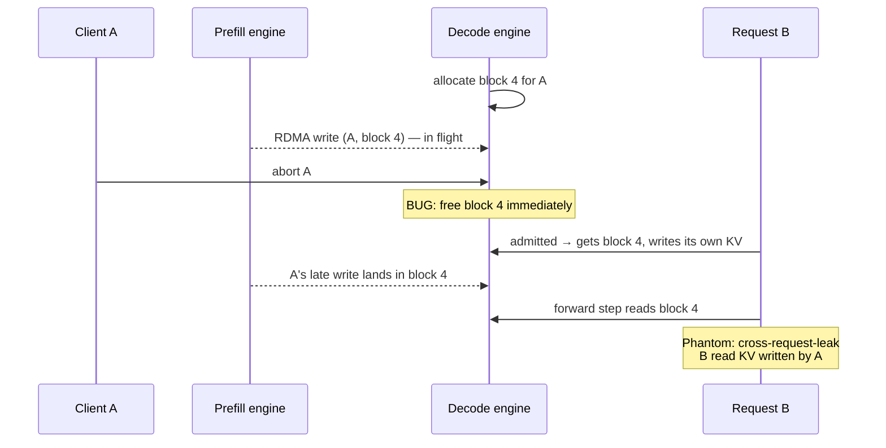

# Phantom — Deterministic Simulation Testing for LLM-Serving KV Caches

[](https://github.com/sameer-sde/phantom-kv/actions/workflows/ci.yml)
[](https://github.com/sameer-sde/phantom-kv/actions/workflows/vllm.yml)
[](https://python.org)
[](#quick-start)
[](#testing)
[](LICENSE)

A testing framework that finds **cross-request data leaks and KV-cache
corruption** in LLM inference engines such as vLLM, SGLang and LMCache.
It does this **exactly** (hash equality, not floating-point comparison),
**on a laptop CPU** (no GPU, no model weights), and **reproducibly** (one
seed replays the entire run, event for event, and failures shrink automatically
to a handful of events).

> Phantom is a model with no weights. To the serving engine it looks like a
> real LLM: it is scheduled, batched, preempted, prefix-cached, and its KV
> cache is shipped between machines. But instead of K/V vectors it writes a
> **provenance tag** into every cache slot, so any slot read by the wrong
> request is caught and the request that wrote it is named.

---

## Why this project

LLM servers squeeze throughput out of GPUs by **sharing memory between
users**: paged KV blocks, prefix caching, preemption, CPU offloading, and
**prefill/decode (PD) disaggregation**, where one machine computes the
prompt's KV cache and streams it to another with one-sided RDMA writes.
When that bookkeeping is wrong, nothing crashes. A user silently gets
corrupted output, or **another user's data**.

These bugs are hard to catch today:

| Problem | Why existing testing struggles |
|---|---|
| **Noisy oracle** | Comparing outputs on real GPUs is ambiguous: a *legitimate* prefix-cache hit already perturbs floating-point numerics, so "different output" ≠ "bug". |
| **Rare interleavings** | The dangerous cases (a client aborts *while* a KV write is in flight) depend on exact timing and almost never reproduce. |
| **Cost** | GPU fuzzing campaigns need expensive hardware and run slowly. |

Phantom addresses all three with two ideas from the distributed-systems
world:

- **An exact oracle.** Provenance tags + prefix chain hashes turn "is this
  KV correct?" into an equality check.
- **Deterministic simulation testing**, the technique behind FoundationDB,
  TigerBeetle's VOPR and Antithesis. A single PRNG seed controls every
  arrival, abort, network delay and memory-pressure event, so any failure
  replays exactly.

---

## Architecture


**Request flow:** the simulator submits a request → the scheduler admits it
(reusing prefix-cache blocks where the chain hash matches) or, for a PD
request, allocates destination blocks and lets the remote prefill stream
KV into them → each forward step, the Phantom model writes tags for new
positions and reads back **every** context slot through the engine's block
table → any mismatch is recorded with the full event trace.

---

## The oracle

Every request has a chain hash per position:
`chain[p] = H(chain[p-1], token[p])`, so `chain[p]` uniquely identifies
the prefix `tokens[0..p]`. The Phantom model writes
`Tag(writer, pos, chain[pos])` into the slot the engine assigns to `pos`.
When it reads the context back:

| What the slot holds | Verdict |
|---|---|
| same chain hash, **any** writer | ✅ correct, including legal prefix sharing between requests |
| nothing (never written) | ❌ `unwritten-read` |
| different chain hash, **another** request | ❌ `cross-request-leak` |
| different chain hash, same request | ❌ `stale-self-read` |

Two slots are interchangeable **iff** their chain hashes match. That is
exactly the rule prefix caching is allowed to exploit, so correct sharing
passes and everything else is flagged, with **zero false positives by
construction**. The next token is a hash of everything read, so a bad read
also changes the visible output, as it would with a real model.

---

## Core mechanisms

| Mechanism | What it does | Where |
|---|---|---|
| **Provenance tags** | Replace K/V tensors with `(writer, pos, chain_hash)`; BLAKE2b-64 chain over the prefix | `phantomkv/provenance.py` |
| **Paged KV block pool** | Fixed-size blocks, refcounts, free list, LRU eviction of unreferenced cached blocks | `phantomkv/engine.py` |
| **Prefix caching** | Full blocks indexed by the chain hash at the block boundary; hits always leave ≥ 1 token to compute so shared blocks are never written | `phantomkv/engine.py` |
| **Recompute preemption** | Under memory pressure the newest running request is evicted and later recomputed | `phantomkv/engine.py` |
| **PD disaggregation** | Decode allocates blocks; remote prefill streams one-sided writes per block with random delay. Writes don't check ownership, just like RDMA | `phantomkv/engine.py`, `phantomkv/sim.py` |
| **Abort handling** | Aborts at any state; blocks with in-flight writes are freed only after the last write lands | `phantomkv/engine.py` |
| **Deterministic simulator** | Seed → explicit event list (arrivals, prompts, shared prefixes, aborts); network delay is a hash of (seed, request, block), so it is stable when events are removed; virtual clock; trace fingerprint | `phantomkv/sim.py` |
| **Liveness + leak checks** | Requests that never finish; blocks still referenced after quiescence | `phantomkv/sim.py`, `phantomkv/engine.py` |
| **Test-case shrinking** | Delta debugging (ddmin) reduces a failing event list to a 1-minimal reproduction with the same violation kind | `phantomkv/shrink.py` |
| **Planted bugs** | Switch on known bug classes to prove the oracle catches them before targeting real engines | `--plant` flag |

---

## The bug class Phantom is built for

The abort-during-transfer race in PD disaggregation, the same class SGLang
disclosed in its
[October 2026 security update](https://www.lmsys.org/blog/2026-10-26-cf-security/):



**Correct behaviour:** blocks with outstanding writes are released only when
the last write lands (or is cancelled and acknowledged).

---

## Validation

Before Phantom is trusted on real engines, it must (1) never raise a false
alarm on a correct engine and (2) catch known bug classes. Measured on a
MacBook-class CPU, 1,000 seeds per row, 40 requests per seed with mixed
local/PD traffic, shared prefixes and 25% client aborts:

| Engine configuration | Failing seeds | Violations reported |
|---|---|---|
| Correct engine | **0 / 1,000** | none (no false positives) |
| Planted `abort-free-race`: free blocks on abort while KV writes are in flight | **545 / 1,000** | `cross-request-leak` |
| Planted `stale-prefix-cache`: evict a cached block but keep its hash entry | **1,000 / 1,000** | `cross-request-leak`, `stale-self-read` |

| Metric | Value |
|---|---|
| Throughput | **~100 seeds/s** (≈ 4,000 simulated requests/s) on one CPU core |
| Determinism | same seed → identical trace fingerprint (tested) |
| Shrinking | ~50 events → **median 6, max 13** (92 failing seeds), ~0.2 s per shrink |
| GPU required | none |

---

## Proof: a real failure, captured end-to-end

```
$ python -m phantomkv fuzz --seeds 1000 --plant abort-free-race
phantomkv: 1000 seeds in 10.6s (94 seeds/s), plant=abort-free-race
545 failing seeds; violation kinds: {'cross-request-leak': 1151}
first failure: seed 0
  [t=10] cross-request-leak: req 12 pos 0: read KV of req 9 pos 4 (prefix differs)
```

53 events are too many for a bug report, so we shrink them:

```
$ python -m phantomkv shrink --seed 0 --plant abort-free-race
shrunk seed 0: 53 events -> 6 (29 runs, 0.06s)

minimal reproduction:
  t=0    submit req 18 prompt_len=15 max_new=1 local
  t=8    submit req 19 prompt_len=22 max_new=2 local
  t=39   submit req 21 prompt_len=23 max_new=2 remote-prefill
  t=40   submit req 17 prompt_len=16 max_new=7 remote-prefill
  t=45   submit req 20 prompt_len=27 max_new=10 local
  t=48   abort  req 21

trace (excerpt):
  t=48    abort req 21 (was waiting_kv, inflight=2)    # client cancels mid-transfer
  t=48    kv-land req 17 blk#2->18 left=1              # buggy engine already freed req 21's
  t=49    kv-land req 17 blk#0->16 left=0              # blocks; req 17 now owns block 10
  t=51    kv-land req 21 blk#0->10 left=0              # req 21's late write lands in block 10
  t=51    VIOLATION cross-request-leak: req 17 pos 16: read KV of req 21 pos 0

=> [t=51] cross-request-leak: req 17 pos 16: read KV of req 21 pos 0 (prefix differs)
```

Every one of the 6 events is necessary: removing any single one makes the
failure disappear (checked in `tests/test_shrink.py`). Same seed, same
output, on any machine.

---

## Running inside real vLLM

Phantom now runs **inside vLLM's real engine** (v0.33 dev, CPU build on Apple
Silicon) as an out-of-tree model plugin. vLLM's own scheduler, KV-cache
manager, prefix cache and block tables decide where every token's KV goes;
Phantom writes a tag there and re-reads the whole context through vLLM's
block table at every step.

```
$ python scripts/vllm_phantom_check.py
STATS: {'steps': 34, 'tokens_written': 748, 'slots_checked': 19776, 'violations': 0}
OUTPUT MISMATCHES: 0
VIOLATIONS: 0
RESULT: PASS
```

8 prompts with long shared prefixes, generated twice: vLLM served 608 of
1,356 positions from its prefix cache, and every one of 19,776 slot reads was
correct. No GPU, no model weights. How it plugs in:
[docs/VLLM_INTEGRATION.md](docs/VLLM_INTEGRATION.md).

### Catching a bug planted inside real vLLM

To prove Phantom catches real failures in the real engine, we plant a known
bug class at runtime (vLLM's source is untouched): `stale-prefix-cache` makes
`BlockPool._maybe_evict_cached_block` forget to remove the hash → block index
entry when it evicts a cached block. Under memory pressure (48 KV blocks plus
a churn phase that forces eviction and reuse):

| vLLM | Slots checked | Violations | Wrong outputs | Result |
|---|---|---|---|---|
| unmodified | 55,872 | 0 | 0 | ✅ PASS |
| `stale-prefix-cache` planted | 47,488 | **96** `misplaced-block` | **7 of 8** | ❌ caught |

```
$ python scripts/vllm_phantom_check.py --pressure --plant stale-prefix-cache
VIOLATIONS: 96 {'misplaced-block': 96}
   {'kind': 'misplaced-block', 'step': 99, 'batch_row': 0, 'pos': 0, 'detail': 'slot 32 holds position 64'}
RESULT: FAIL
```

A request asked for its first prompt block; the stale index pointed it at a
block that had been recycled for another request's positions 64–95. Phantom
names the exact slot.

### Seeded, step-by-step fuzzing of real vLLM

`phantomkv vllm-fuzz` drives vLLM's real `LLMEngine` one `step()` at a time
from a seeded event list: 24 requests per seed with shared prefixes of 1–3
whole blocks, ~25% of them aborted at chosen steps, under a 48-block KV cache.
Every output (including partial outputs of aborted requests) is compared with
the reference.

| Run | Result |
|---|---|
| unmodified vLLM, 20 seeds, each run twice (`--check-determinism`) | ✅ 0 violations; every seed identical across both runs |
| `--plant stale-prefix-cache`, 20 seeds | ❌ **caught on 15 of 20 seeds** |

Each seed sends 24 requests, then a second wave of 10 that come back for the
first blocks of earlier prompts after the cache has churned, which is exactly when
a stale cache entry does damage. ~190 requests/s on one CPU core. Along the way Phantom raised one false alarm
on unmodified vLLM; it was traced to Phantom (vLLM caches blocks at schedule
time, so the model must write the whole batch before checking, like real
attention) and fixed. See the [devlog](docs/DEVLOG.md#day-7--2026-11-02).

### Shrinking a real-vLLM failure

`phantomkv vllm-shrink` runs delta debugging against the real engine,
re-running vLLM for every candidate event list:

```
$ python -m phantomkv vllm-shrink --seed 1 --plant stale-prefix-cache
shrunk seed 1: 38 events -> 13 (235 vLLM runs, 12.5s), kind=misplaced-block
reproduces 3/3 times on fresh re-runs

minimal reproduction (same letter = same first 32-token block):
  step 5    submit req 11  prompt_len=110  first_block=A max_new=13
  ...       9 requests with prefixes B..H fill the 48-block cache
  step 87   submit req 33  prompt_len=52   first_block=A max_new=6
  step 97   submit req 31  prompt_len=113  first_block=A max_new=3

violations in the minimal run:
   {'kind': 'misplaced-block', ..., 'pos': 64, 'detail': 'slot 224 holds position 96'}
```

Prefix A is cached, evicted under pressure, and requested again; the stale
index entry hands the new request recycled memory. Every one of the 13 events
is necessary.


### Phase 3: stressing different parts of vLLM

Each profile runs vLLM with a different configuration; every run reports
vLLM's own counters as proof that the stressed path was really exercised.

| Profile | Unmodified vLLM (20 seeds × 2 runs) | `stale-prefix-cache` planted | Evidence the path was exercised |
|---|---|---|---|
| baseline | ✅ PASS | ❌ caught 15/20 | 33% prefix-cache hit rate |
| chunked-prefill (≤64 tokens/step) | ✅ PASS | ❌ caught 15/20 | **498 chunked-prefill continuations**, max 64 tokens/step |
| preemption (24 blocks, 8 seqs) | ✅ PASS | ❌ caught **20/20** | **16 preemptions** |
| block64 (64-token blocks) | ✅ PASS | ❌ caught 16/20 | 29% hit rate |

```
bash scripts/vllm_campaign.sh
```

**A second bug class, and what it taught us.** `missing-touch` plants a
refcount bug (a shared block isn't counted for its second owner). Here vLLM
defends itself: `assert block.ref_cnt == 0` in `BlockPool.get_new_blocks()`
(`block_pool.py:730`) fires when the wrongly freed block is handed out again,
before any corruption is visible to Phantom. Bugs that make vLLM's bookkeeping
*inconsistent* are caught by vLLM's own assertions; bugs that leave it
*consistent but wrong*, like a stale index entry, trip nothing, and that is
where Phantom is needed.

Two things the counters and determinism checks exposed along the way: vLLM's
CPU platform silently disables async scheduling (so that profile was dropped),
and the multiprocess engine let aborts arrive a step late. The harness now
runs the engine in-process so every add, abort and step is exact. Details in
the [devlog](docs/DEVLOG.md#day-10--2026-11-03).


### Phase 4: two vLLM engines, KV transferred between them

Disaggregated serving splits a request across a *prefill* engine and a
*decode* engine; the KV cache is shipped between them. Phantom now runs on
both sides: the prefill engine (one process) saves each prompt's KV through
vLLM's `ExampleConnector`, and the decode engine (another process) loads it
into its own slots and continues.

```
$ python scripts/vllm_pd_check.py
PREFILL: 8 prompts, KV files saved: 8
DECODE STATS: {... 'slots_checked': 12624, 'violations': 0, 'context_not_computed_here': 864}
DECODE OUTPUT MISMATCHES: 0
RESULT: PASS
```

864 is exactly the number of positions the connector should transfer for
these prompts; every one, plus the seam where locally computed KV takes over,
was verified in the decode engine.

**Faults in the transfer.** `PhantomFaultConnector` (vLLM's connector plus
planted bugs, loaded via `kv_connector_module_path`) breaks the transfer
silently, so nothing raises and shapes match:

| Fault | What goes wrong | Phantom saw | Result |
|---|---|---|---|
| none | — | 0 violations, 0 wrong outputs | ✅ PASS |
| `swap` | decode receives another prompt's KV | **4 wrong outputs** for the 4 swapped requests | ❌ caught |
| `silent-drop` | load reported done, nothing written | **96 `unwritten-read`** violations | ❌ caught |

**Abort while KV is still in flight (the SGLang Oct-2026 bug class).** With an
asynchronous connector, KV lands 3 steps after the load starts, one-sided like
RDMA. Four requests are aborted while their KV is in flight, then filler
requests take whatever blocks are free:

| vLLM | Late landings | Phantom saw | Result |
|---|---|---|---|
| unmodified (holds an aborted request's blocks until its load lands) | 4 | 0 violations, 0 wrong outputs | ✅ PASS |
| `abort-free-race` planted (frees them immediately) | 4 | **54 `misplaced-block`** at the step the loads landed, **5 fillers corrupted** | ❌ caught |

```
$ python scripts/vllm_pd_check.py --abort-mid-transfer --plant abort-free-race
ABORTED while KV in flight: ['d0', 'd2', 'd4', 'd6']
DECODE VIOLATIONS: 54
   {'kind': 'misplaced-block', 'step': 4, 'batch_row': 0, 'pos': 0, 'detail': 'slot 800 holds position 96'}
RESULT: CAUGHT
```

**Seeded two-engine fuzzing.** `phantomkv pd-fuzz` turns this into a search:
each seed picks the load delay (1-5 steps), which prefilled prompts to
transfer and when, which to abort (before the load starts, while KV is in
flight, after it lands) and when local requests arrive to take freed blocks.
Every abort is classified from the connector's log, so a campaign proves the
race was actually exercised.

| 20 seeds | Failing | Evidence |
|---|---|---|
| unmodified vLLM (each seed run twice) | **0**, deterministic | 137 async loads, 94 aborts, **35 while KV was in flight** |
| `abort-free-race` planted | **14 caught** | 93 `misplaced-block`, 18 `chain-break`, 19 wrong outputs |

A failing seed shrinks to the whole bug in two events:

```
$ python -m phantomkv pd-shrink --seed 0 --plant abort-free-race
shrunk seed 0 (load delay 4 steps): 24 events -> 2 (36 vLLM runs, 0.4s), kind=misplaced-block
reproduces 3/3 times on fresh re-runs

  step 3    submit req 1   prompt_len=130  max_new=9   TRANSFERRED (KV from prefill engine)
  step 4    abort  req 1
   {'kind': 'misplaced-block', 'pos': 0, 'detail': 'slot 416 holds position 96'}
```

**Campaign, 200 seeds per run** (`bash scripts/pd_campaign.sh`): the same
scenarios against unmodified vLLM and against every planted bug and fault.

| Decode engine | Failing seeds | Result |
|---|---|---|
| unmodified vLLM (each seed run twice) | **0/200**, deterministic | ✅ PASS |
| `abort-free-race` (frees blocks while KV is in flight) | 115/200 | ❌ caught |
| `swap` (another request's KV) | 199/200 | ❌ caught |
| `silent-drop` (load reported done, nothing written) | 199/200 | ❌ caught |
| `duplicate` (stale copy of a write lands later) | 184/200 | ❌ caught |

1,371 async loads, 995 aborts (335 while KV was in flight), 73,376 transferred
tokens read. The one seed swap and silent-drop did not break is seed 159: every
request whose KV was transferred was aborted before reading it
(`transferred_tokens=0`), so there was nothing to corrupt.

```
python scripts/vllm_pd_check.py --fault swap
```

A swapped context is a *valid chain for the wrong prompt*: every slot extends
the one before it, so the in-model check can't see it, but the output check
against the true prompt does. An empty slot is caught in-model on the first
read. Two independent oracles, each catching what the other can't. All of these
runs are part of CI. Design: [docs/PD_DESIGN.md](docs/PD_DESIGN.md).

---

## Quick start

### Requirements

- Python 3.10+
- No third-party dependencies (pytest for tests)

### Install

```bash
git clone https://github.com/sameer-sde/phantom-kv.git
cd phantom-kv
pip install -e ".[dev]"
```

### Run

```bash
# Correct engine: expect "no violations found"
python -m phantomkv fuzz --seeds 1000

# Prove the oracle catches a known bug class
python -m phantomkv fuzz --seeds 1000 --plant abort-free-race

# Replay one failing seed and print the story leading to the violation
python -m phantomkv replay --seed 0 --plant abort-free-race

# Shrink it to a minimal reproduction for a bug report
python -m phantomkv shrink --seed 0 --plant abort-free-race

# Heavier fault mix
python -m phantomkv fuzz --seeds 500 --remote-frac 0.9 --abort-frac 0.5
```

### CLI reference

| Command | Flags |
|---|---|
| `fuzz` | `--seeds N` · `--start S` · `--plant {abort-free-race, stale-prefix-cache}` · `--remote-frac F` · `--abort-frac F` · `--stop-first` |
| `replay` | `--seed N` · `--plant …` · `--context K` (trace lines before the violation) · `--full` |
| `shrink` | `--seed N` · `--plant …` |
| `vllm-fuzz` | `--seeds N` · `--start S` · `--profile NAME` · `--plant NAME` · `--check-determinism` · `-v` (needs the vLLM environment) |
| `vllm-shrink` | `--seed N` · `--profile NAME` · `--plant NAME` (needs the vLLM environment) |

---

## Testing

```bash
pytest -q
```

| Test | Guarantees |
|---|---|
| `test_no_false_positives_on_correct_engine` | 300 seeds, all requests finish or abort, zero violations |
| `test_no_false_positives_under_heavy_pressure` | 12 blocks, 80% PD, 50% aborts: still zero violations |
| `test_prefix_cache_is_exercised` | the workload actually produces prefix-cache hits (no vacuous passes) |
| `test_planted_bug_is_caught[*]` | every planted bug class is detected |
| `test_abort_race_is_reported_as_cross_request_leak` | the race is classified correctly |
| `test_same_seed_same_run` / `test_different_seeds_differ` | determinism |
| `test_event_list_reproduces_seed_exactly` | seed → event list → identical run |
| `test_network_delay_independent_of_other_events` | removing events doesn't perturb other requests' timing |
| `test_shrunk_repro_is_small_and_still_fails[*]` | ≤ 15 events, same violation kind |
| `test_shrunk_repro_is_one_minimal[*]` | removing any single event makes the failure disappear |
| `test_ddmin_*` | the minimiser itself |

CI runs on every push:

* **`ci`**: the test suite on Python 3.10 and 3.12, plus a 1,000-seed clean fuzz of the simulator.
* **`real-vllm`**: installs vLLM's Linux CPU wheel (pinned) and runs
  [`scripts/ci_vllm.sh`](scripts/ci_vllm.sh). Unmodified vLLM must pass every check
  (no false positives), and with a bug planted in vLLM's block pool the checks
  must fail (no false negatives).

---

## Roadmap

| Phase | Status |
|---|---|
| 0. Exact oracle + deterministic simulator, validated on a toy engine | ✅ done |
| 1. Test-case shrinking: failing seed → minimal event trace | ✅ done |
| 2. Phantom as an out-of-tree **vLLM** model on the CPU backend, writing tags through vLLM's real block tables and slot mappings | ✅ done: runs inside real vLLM, planted bug caught (15/20 seeds), seeded step-by-step fuzzing + shrinking, real-vLLM checks in CI on every push |
| 3. More chaos on real vLLM: chunked prefill, preemption, block sizes | ✅ 4 profiles clean on unmodified vLLM, `stale-prefix-cache` caught in each, chunking/preemption proven by counters; refcount bugs shown to be caught by vLLM's own assertions |
| 4. Two-engine PD disaggregation with transfer faults (swap, drop, duplicate, abort mid-transfer) | ✅ v0.5.0: SGLang Oct-2026 class reproduced and caught; seeded PD fuzzing + shrinking; 200-seed campaign 0 false positives, every planted bug and fault caught; all in CI |
| 5. Bug-hunting campaigns on vLLM, SGLang, LMCache, llm-d; issues and fix PRs upstream | 🔄 target 1: vLLM's CPU KV offloading runs on the CPU backend with its manager unmodified; 7 profiles clean and deterministic, planted offload fault caught, in CI ([design](docs/OFFLOAD_DESIGN.md)); no bug found yet |

Releases: [v0.1.0 – v0.5.0](https://github.com/sameer-sde/phantom-kv/releases), one per finished phase ([CHANGELOG](CHANGELOG.md)).

Details: [docs/ROADMAP.md](docs/ROADMAP.md) · design: [docs/DESIGN.md](docs/DESIGN.md) · vLLM integration: [docs/VLLM_INTEGRATION.md](docs/VLLM_INTEGRATION.md) · daily progress: [docs/DEVLOG.md](docs/DEVLOG.md)

---

## Project structure

```
phantom-kv/
├── phantomkv/
│   ├── provenance.py      # Tag, chain hashes, phantom attention + LM head
│   ├── engine.py          # ToyEngine: paged KV, prefix cache, preemption, PD, aborts, oracle
│   ├── sim.py             # Event list, workload generator, deterministic simulator
│   ├── shrink.py          # ddmin delta debugging → minimal reproductions
│   ├── cli.py             # fuzz / replay / shrink commands
│   ├── tags.py            # float32-exact tag encoding + reference outputs
│   ├── vllm_model.py      # PhantomForCausalLM: writes/verifies tags in vLLM's KV cache
│   ├── vllm_plugin.py     # registers it with vLLM (vllm.general_plugins)
│   ├── vllm_plants.py     # known bug classes planted into vLLM at runtime
│   ├── vllm_fault_connector.py # ExampleConnector + planted transfer faults
│   ├── vllm_harness.py    # seeded step-by-step driver for real vLLM
│   ├── vllm_pd.py         # seeded two-engine (prefill/decode) fuzzing + shrinking
│   ├── vllm_offload.py    # vLLM's CPU KV offloading on the CPU backend (copy engine only replaced)
│   ├── vllm_offload2.py   # vLLM's OffloadingConnector, via its pluggable OffloadingSpec
│   ├── offload_map.py     # block <-> chunk mapping for offloaded KV
│   └── __main__.py        # python -m phantomkv
├── tests/
│   ├── test_oracle.py     # no false positives · planted bugs caught · determinism
│   ├── test_shrink.py     # minimal, still-failing, 1-minimal reproductions
│   ├── test_tags.py       # tags round-trip exactly through float32
│   └── test_pd_workload.py # seeded PD scenarios: delays, abort timings, fillers
├── docs/
│   ├── DESIGN.md          # oracle, determinism, mapping to vLLM
│   ├── VLLM_INTEGRATION.md # phase 2: code map + PhantomForCausalLM design
│   ├── PD_DESIGN.md       # phase 4: disaggregated prefill/decode + fault plan
│   ├── OFFLOAD_DESIGN.md  # phase 5 target 1: vLLM's CPU KV offloading
│   ├── OFFLOAD2_DESIGN.md # phase 5 target 2: vLLM's OffloadingConnector
│   ├── ROADMAP.md         # phases and exit criteria
│   └── DEVLOG.md          # daily engineering log
├── scripts/
│   ├── vllm_smoke.py      # does vLLM (CPU) run on this machine?
│   ├── ci_vllm.sh         # real-vLLM acceptance checks (CI + local)
│   ├── vllm_campaign.sh   # every profile, unmodified + planted
│   ├── pd_campaign.sh     # two engines: unmodified + every planted bug and fault
│   ├── vllm_phantom_hello.py  # does real vLLM load and run Phantom?
│   ├── vllm_phantom_check.py  # end-to-end check: --pressure, --plant
│   └── vllm_pd_check.py   # two engines (prefill + decode) via ExampleConnector
├── CHANGELOG.md           # what each release (phase) added
├── .github/workflows/
│   ├── ci.yml             # unit tests + simulator fuzz
│   └── vllm.yml           # Phantom inside real vLLM (pinned CPU wheel)
└── pyproject.toml
```

---

## References

- Kwon, W., et al. (2023). Efficient Memory Management for Large Language Model Serving with PagedAttention (vLLM). SOSP 2023. https://arxiv.org/abs/2309.06180
- Zheng, L., et al. (2024). SGLang: Efficient Execution of Structured Language Model Programs. https://arxiv.org/abs/2312.07104
- Zhou, J., et al. (2021). FoundationDB: A Distributed Unbundled Transactional Key Value Store. SIGMOD 2021. Simulation testing: https://apple.github.io/foundationdb/testing.html
- TigerBeetle VOPR simulator. https://github.com/tigerbeetle/tigerbeetle
- Kingsbury, K. Jepsen: distributed systems safety research. https://jepsen.io
- Zeller, A., & Hildebrandt, R. (2002). Simplifying and Isolating Failure-Inducing Input. IEEE Transactions on Software Engineering 28(2).
- Meng, R., et al. (2023). Greybox Fuzzing of Distributed Systems (Mallory). ACM CCS 2023. https://arxiv.org/abs/2305.02601
- GRIEF: Continuous Discovery of Vulnerabilities in LLM Serving Systems with Fuzzing (2026). https://arxiv.org/abs/2605.11202
- Gu, Y., et al. (2026). Ekka: Automated Diagnosis of Silent Errors in LLM Inference. ICML 2026.
- LMSYS (2026). SGLang security update: improving request isolation. https://www.lmsys.org/blog/2026-10-26-cf-security/

---

## Author

**Sameer Ahmed** · [GitHub](https://github.com/sameer-sde)

Related work: [vLLM PR #54832](https://github.com/vllm-project/vllm/pull/54832) ·
[RaftKV](https://github.com/sameer-sde/raftKv) ·
[Sentinel](https://github.com/sameer-sde/sentinel) ·
[Vektr](https://github.com/sameer-sde/vektr)

License: [MIT](LICENSE)
