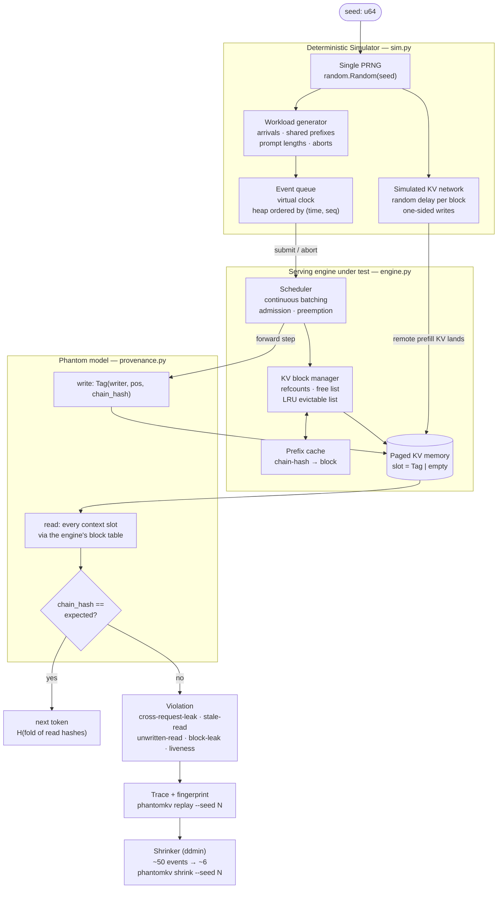
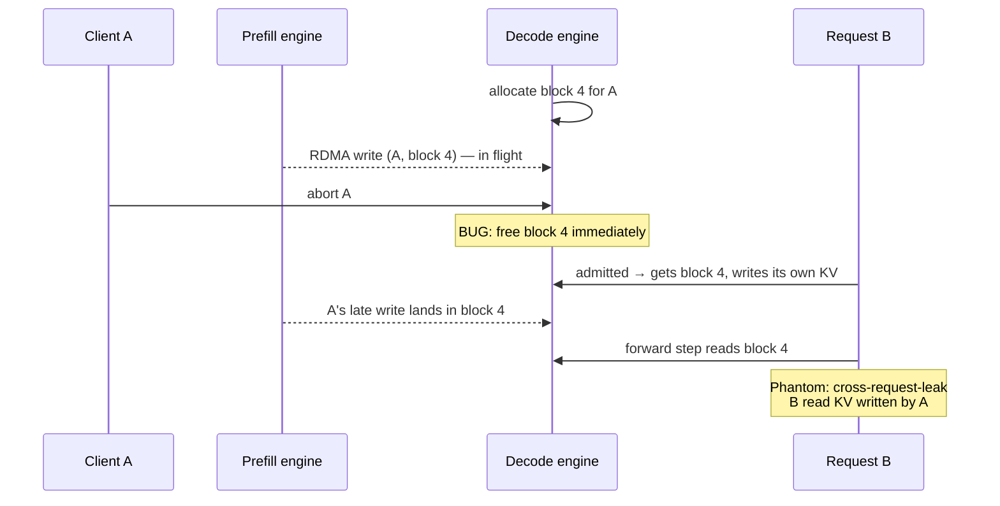

# Phantom — Deterministic Simulation Testing for LLM-Serving KV Caches

[](https://github.com/sameer-sde/phantom-kv/actions/workflows/ci.yml)
[](https://python.org)
[](#quick-start)
[](#testing)
[](LICENSE)

A testing framework that finds **cross-request data leaks and KV-cache
corruption** in LLM inference engines such as vLLM, SGLang and LMCache.
It does this **exactly** (hash equality, not floating-point comparison),
**on a laptop CPU** (no GPU, no model weights), and **reproducibly** (one
seed replays the entire run, event for event, and failures shrink automatically
to a handful of events).

> Phantom is a model with no weights. To the serving engine it looks like a
> real LLM: it is scheduled, batched, preempted, prefix-cached, and its KV
> cache is shipped between machines. But instead of K/V vectors it writes a
> **provenance tag** into every cache slot, so any slot read by the wrong
> request is caught and the request that wrote it is named.

---

## Why this project

LLM servers squeeze throughput out of GPUs by **sharing memory between
users**: paged KV blocks, prefix caching, preemption, CPU offloading, and
**prefill/decode (PD) disaggregation**, where one machine computes the
prompt's KV cache and streams it to another with one-sided RDMA writes.
When that bookkeeping is wrong, nothing crashes. A user silently gets
corrupted output, or **another user's data**.

These bugs are hard to catch today:

| Problem | Why existing testing struggles |
|---|---|
| **Noisy oracle** | Comparing outputs on real GPUs is ambiguous: a *legitimate* prefix-cache hit already perturbs floating-point numerics, so "different output" ≠ "bug". |
| **Rare interleavings** | The dangerous cases (a client aborts *while* a KV write is in flight) depend on exact timing and almost never reproduce. |
| **Cost** | GPU fuzzing campaigns need expensive hardware and run slowly. |

Phantom addresses all three with two ideas from the distributed-systems
world:

- **An exact oracle.** Provenance tags + prefix chain hashes turn "is this
  KV correct?" into an equality check.
- **Deterministic simulation testing**, the technique behind FoundationDB,
  TigerBeetle's VOPR and Antithesis. A single PRNG seed controls every
  arrival, abort, network delay and memory-pressure event, so any failure
  replays exactly.

---

## Architecture



**Request flow:** the simulator submits a request → the scheduler admits it
(reusing prefix-cache blocks where the chain hash matches) or, for a PD
request, allocates destination blocks and lets the remote prefill stream
KV into them → each forward step, the Phantom model writes tags for new
positions and reads back **every** context slot through the engine's block
table → any mismatch is recorded with the full event trace.

---

## The oracle

Every request has a chain hash per position:
`chain[p] = H(chain[p-1], token[p])`, so `chain[p]` uniquely identifies
the prefix `tokens[0..p]`. The Phantom model writes
`Tag(writer, pos, chain[pos])` into the slot the engine assigns to `pos`.
When it reads the context back:

| What the slot holds | Verdict |
|---|---|
| same chain hash, **any** writer | ✅ correct, including legal prefix sharing between requests |
| nothing (never written) | ❌ `unwritten-read` |
| different chain hash, **another** request | ❌ `cross-request-leak` |
| different chain hash, same request | ❌ `stale-self-read` |

Two slots are interchangeable **iff** their chain hashes match. That is
exactly the rule prefix caching is allowed to exploit, so correct sharing
passes and everything else is flagged, with **zero false positives by
construction**. The next token is a hash of everything read, so a bad read
also changes the visible output, as it would with a real model.

---

## Core mechanisms

| Mechanism | What it does | Where |
|---|---|---|
| **Provenance tags** | Replace K/V tensors with `(writer, pos, chain_hash)`; BLAKE2b-64 chain over the prefix | `phantomkv/provenance.py` |
| **Paged KV block pool** | Fixed-size blocks, refcounts, free list, LRU eviction of unreferenced cached blocks | `phantomkv/engine.py` |
| **Prefix caching** | Full blocks indexed by the chain hash at the block boundary; hits always leave ≥ 1 token to compute so shared blocks are never written | `phantomkv/engine.py` |
| **Recompute preemption** | Under memory pressure the newest running request is evicted and later recomputed | `phantomkv/engine.py` |
| **PD disaggregation** | Decode allocates blocks; remote prefill streams one-sided writes per block with random delay. Writes don't check ownership, just like RDMA | `phantomkv/engine.py`, `phantomkv/sim.py` |
| **Abort handling** | Aborts at any state; blocks with in-flight writes are freed only after the last write lands | `phantomkv/engine.py` |
| **Deterministic simulator** | Seed → explicit event list (arrivals, prompts, shared prefixes, aborts); network delay is a hash of (seed, request, block), so it is stable when events are removed; virtual clock; trace fingerprint | `phantomkv/sim.py` |
| **Liveness + leak checks** | Requests that never finish; blocks still referenced after quiescence | `phantomkv/sim.py`, `phantomkv/engine.py` |
| **Test-case shrinking** | Delta debugging (ddmin) reduces a failing event list to a 1-minimal reproduction with the same violation kind | `phantomkv/shrink.py` |
| **Planted bugs** | Switch on known bug classes to prove the oracle catches them before targeting real engines | `--plant` flag |

---

## The bug class Phantom is built for

The abort-during-transfer race in PD disaggregation, the same class SGLang
disclosed in its
[October 2026 security update](https://www.lmsys.org/blog/2026-10-26-cf-security/):



**Correct behaviour:** blocks with outstanding writes are released only when
the last write lands (or is cancelled and acknowledged).

---

## Validation

Before Phantom is trusted on real engines, it must (1) never raise a false
alarm on a correct engine and (2) catch known bug classes. Measured on a
MacBook-class CPU, 1,000 seeds per row, 40 requests per seed with mixed
local/PD traffic, shared prefixes and 25% client aborts:

| Engine configuration | Failing seeds | Violations reported |
|---|---|---|
| Correct engine | **0 / 1,000** | none (no false positives) |
| Planted `abort-free-race`: free blocks on abort while KV writes are in flight | **545 / 1,000** | `cross-request-leak` |
| Planted `stale-prefix-cache`: evict a cached block but keep its hash entry | **1,000 / 1,000** | `cross-request-leak`, `stale-self-read` |

| Metric | Value |
|---|---|
| Throughput | **~100 seeds/s** (≈ 4,000 simulated requests/s) on one CPU core |
| Determinism | same seed → identical trace fingerprint (tested) |
| Shrinking | ~50 events → **median 6, max 13** (92 failing seeds), ~0.2 s per shrink |
| GPU required | none |

---

## Proof: a real failure, captured end-to-end

```
$ python -m phantomkv fuzz --seeds 1000 --plant abort-free-race
phantomkv: 1000 seeds in 10.6s (94 seeds/s), plant=abort-free-race
545 failing seeds; violation kinds: {'cross-request-leak': 1151}
first failure: seed 0
  [t=10] cross-request-leak: req 12 pos 0: read KV of req 9 pos 4 (prefix differs)
```

53 events are too many for a bug report, so we shrink them:

```
$ python -m phantomkv shrink --seed 0 --plant abort-free-race
shrunk seed 0: 53 events -> 6 (29 runs, 0.06s)

minimal reproduction:
  t=0    submit req 18 prompt_len=15 max_new=1 local
  t=8    submit req 19 prompt_len=22 max_new=2 local
  t=39   submit req 21 prompt_len=23 max_new=2 remote-prefill
  t=40   submit req 17 prompt_len=16 max_new=7 remote-prefill
  t=45   submit req 20 prompt_len=27 max_new=10 local
  t=48   abort  req 21

trace (excerpt):
  t=48    abort req 21 (was waiting_kv, inflight=2)    # client cancels mid-transfer
  t=48    kv-land req 17 blk#2->18 left=1              # buggy engine already freed req 21's
  t=49    kv-land req 17 blk#0->16 left=0              # blocks; req 17 now owns block 10
  t=51    kv-land req 21 blk#0->10 left=0              # req 21's late write lands in block 10
  t=51    VIOLATION cross-request-leak: req 17 pos 16: read KV of req 21 pos 0

=> [t=51] cross-request-leak: req 17 pos 16: read KV of req 21 pos 0 (prefix differs)
```

Every one of the 6 events is necessary: removing any single one makes the
failure disappear (checked in `tests/test_shrink.py`). Same seed, same
output, on any machine.

---

## Running inside real vLLM

Phantom now runs **inside vLLM's real engine** (v0.33 dev, CPU build on Apple
Silicon) as an out-of-tree model plugin. vLLM's own scheduler, KV-cache
manager, prefix cache and block tables decide where every token's KV goes;
Phantom writes a tag there and re-reads the whole context through vLLM's
block table at every step.

```
$ python scripts/vllm_phantom_check.py
STATS: {'steps': 34, 'tokens_written': 748, 'slots_checked': 19776, 'violations': 0}
OUTPUT MISMATCHES: 0
VIOLATIONS: 0
RESULT: PASS
```

8 prompts with long shared prefixes, generated twice: vLLM served 608 of
1,356 positions from its prefix cache, and every one of 19,776 slot reads was
correct. No GPU, no model weights. How it plugs in:
[docs/VLLM_INTEGRATION.md](docs/VLLM_INTEGRATION.md).

### Catching a bug planted inside real vLLM

To prove Phantom catches real failures in the real engine, we plant a known
bug class at runtime (vLLM's source is untouched): `stale-prefix-cache` makes
`BlockPool._maybe_evict_cached_block` forget to remove the hash → block index
entry when it evicts a cached block. Under memory pressure (48 KV blocks plus
a churn phase that forces eviction and reuse):

| vLLM | Slots checked | Violations | Wrong outputs | Result |
|---|---|---|---|---|
| unmodified | 55,872 | 0 | 0 | ✅ PASS |
| `stale-prefix-cache` planted | 47,488 | **96** `misplaced-block` | **7 of 8** | ❌ caught |

```
$ python scripts/vllm_phantom_check.py --pressure --plant stale-prefix-cache
VIOLATIONS: 96 {'misplaced-block': 96}
   {'kind': 'misplaced-block', 'step': 99, 'batch_row': 0, 'pos': 0, 'detail': 'slot 32 holds position 64'}
RESULT: FAIL
```

A request asked for its first prompt block; the stale index pointed it at a
block that had been recycled for another request's positions 64–95. Phantom
names the exact slot.

---

## Quick start

### Requirements

- Python 3.10+
- No third-party dependencies (pytest for tests)

### Install

```bash
git clone https://github.com/sameer-sde/phantom-kv.git
cd phantom-kv
pip install -e ".[dev]"
```

### Run

```bash
# Correct engine: expect "no violations found"
python -m phantomkv fuzz --seeds 1000

# Prove the oracle catches a known bug class
python -m phantomkv fuzz --seeds 1000 --plant abort-free-race

# Replay one failing seed and print the story leading to the violation
python -m phantomkv replay --seed 0 --plant abort-free-race

# Shrink it to a minimal reproduction for a bug report
python -m phantomkv shrink --seed 0 --plant abort-free-race

# Heavier fault mix
python -m phantomkv fuzz --seeds 500 --remote-frac 0.9 --abort-frac 0.5
```

### CLI reference

| Command | Flags |
|---|---|
| `fuzz` | `--seeds N` · `--start S` · `--plant {abort-free-race, stale-prefix-cache}` · `--remote-frac F` · `--abort-frac F` · `--stop-first` |
| `replay` | `--seed N` · `--plant …` · `--context K` (trace lines before the violation) · `--full` |
| `shrink` | `--seed N` · `--plant …` |

---

## Testing

```bash
pytest -q
```

| Test | Guarantees |
|---|---|
| `test_no_false_positives_on_correct_engine` | 300 seeds, all requests finish or abort, zero violations |
| `test_no_false_positives_under_heavy_pressure` | 12 blocks, 80% PD, 50% aborts: still zero violations |
| `test_prefix_cache_is_exercised` | the workload actually produces prefix-cache hits (no vacuous passes) |
| `test_planted_bug_is_caught[*]` | every planted bug class is detected |
| `test_abort_race_is_reported_as_cross_request_leak` | the race is classified correctly |
| `test_same_seed_same_run` / `test_different_seeds_differ` | determinism |
| `test_event_list_reproduces_seed_exactly` | seed → event list → identical run |
| `test_network_delay_independent_of_other_events` | removing events doesn't perturb other requests' timing |
| `test_shrunk_repro_is_small_and_still_fails[*]` | ≤ 15 events, same violation kind |
| `test_shrunk_repro_is_one_minimal[*]` | removing any single event makes the failure disappear |
| `test_ddmin_*` | the minimiser itself |

CI runs the test suite on Python 3.10 and 3.12 plus a 1,000-seed clean fuzz on every push.

---

## Roadmap

| Phase | Status |
|---|---|
| 0. Exact oracle + deterministic simulator, validated on a toy engine | ✅ done |
| 1. Test-case shrinking: failing seed → minimal event trace | ✅ done |
| 2. Phantom as an out-of-tree **vLLM** model on the CPU backend, writing tags through vLLM's real block tables and slot mappings | 🔄 in progress: vLLM CPU build on Apple Silicon ✅, [design](docs/VLLM_INTEGRATION.md) ✅, Phantom loads and runs inside real vLLM as a plugin ✅, tags verified in vLLM's real KV cache ✅, planted vLLM bug caught under memory pressure ✅ |
| 3. Seeded fault injection against vLLM's real `EngineCore` | ⏳ |
| 4. Two-engine PD disaggregation with transfer faults (delay, reorder, duplicate, abort mid-transfer, handshake failure) | ⏳ |
| 5. Bug-hunting campaigns on vLLM, SGLang, LMCache, llm-d; issues and fix PRs upstream | ⏳ |

Details: [docs/ROADMAP.md](docs/ROADMAP.md) · design: [docs/DESIGN.md](docs/DESIGN.md) · vLLM integration: [docs/VLLM_INTEGRATION.md](docs/VLLM_INTEGRATION.md) · daily progress: [docs/DEVLOG.md](docs/DEVLOG.md)

---

## Project structure

```
phantom-kv/
├── phantomkv/
│   ├── provenance.py      # Tag, chain hashes, phantom attention + LM head
│   ├── engine.py          # ToyEngine: paged KV, prefix cache, preemption, PD, aborts, oracle
│   ├── sim.py             # Event list, workload generator, deterministic simulator
│   ├── shrink.py          # ddmin delta debugging → minimal reproductions
│   ├── cli.py             # fuzz / replay / shrink commands
│   ├── tags.py            # float32-exact tag encoding + reference outputs
│   ├── vllm_model.py      # PhantomForCausalLM: writes/verifies tags in vLLM's KV cache
│   ├── vllm_plugin.py     # registers it with vLLM (vllm.general_plugins)
│   ├── vllm_plants.py     # known bug classes planted into vLLM at runtime
│   └── __main__.py        # python -m phantomkv
├── tests/
│   ├── test_oracle.py     # no false positives · planted bugs caught · determinism
│   ├── test_shrink.py     # minimal, still-failing, 1-minimal reproductions
│   └── test_tags.py       # tags round-trip exactly through float32
├── docs/
│   ├── DESIGN.md          # oracle, determinism, mapping to vLLM
│   ├── VLLM_INTEGRATION.md # phase 2: code map + PhantomForCausalLM design
│   ├── ROADMAP.md         # phases and exit criteria
│   └── DEVLOG.md          # daily engineering log
├── scripts/
│   ├── vllm_smoke.py      # does vLLM (CPU) run on this machine?
│   ├── vllm_phantom_hello.py  # does real vLLM load and run Phantom?
│   └── vllm_phantom_check.py  # end-to-end check: --pressure, --plant
├── .github/workflows/ci.yml
└── pyproject.toml
```

---

## References

- Kwon, W., et al. (2023). Efficient Memory Management for Large Language Model Serving with PagedAttention (vLLM). SOSP 2023. https://arxiv.org/abs/2309.06180
- Zheng, L., et al. (2024). SGLang: Efficient Execution of Structured Language Model Programs. https://arxiv.org/abs/2312.07104
- Zhou, J., et al. (2021). FoundationDB: A Distributed Unbundled Transactional Key Value Store. SIGMOD 2021. Simulation testing: https://apple.github.io/foundationdb/testing.html
- TigerBeetle VOPR simulator. https://github.com/tigerbeetle/tigerbeetle
- Kingsbury, K. Jepsen: distributed systems safety research. https://jepsen.io
- Zeller, A., & Hildebrandt, R. (2002). Simplifying and Isolating Failure-Inducing Input. IEEE Transactions on Software Engineering 28(2).
- Meng, R., et al. (2023). Greybox Fuzzing of Distributed Systems (Mallory). ACM CCS 2023. https://arxiv.org/abs/2305.02601
- GRIEF: Continuous Discovery of Vulnerabilities in LLM Serving Systems with Fuzzing (2026). https://arxiv.org/abs/2605.11202
- Gu, Y., et al. (2026). Ekka: Automated Diagnosis of Silent Errors in LLM Inference. ICML 2026.
- LMSYS (2026). SGLang security update: improving request isolation. https://www.lmsys.org/blog/2026-10-26-cf-security/

---

## Author

**Sameer Ahmed** · [GitHub](https://github.com/sameer-sde)

Related work: [vLLM PR #54832](https://github.com/vllm-project/vllm/pull/54832) ·
[RaftKV](https://github.com/sameer-sde/raftKv) ·
[Sentinel](https://github.com/sameer-sde/sentinel) ·
[Vektr](https://github.com/sameer-sde/vektr)

License: [MIT](LICENSE)
